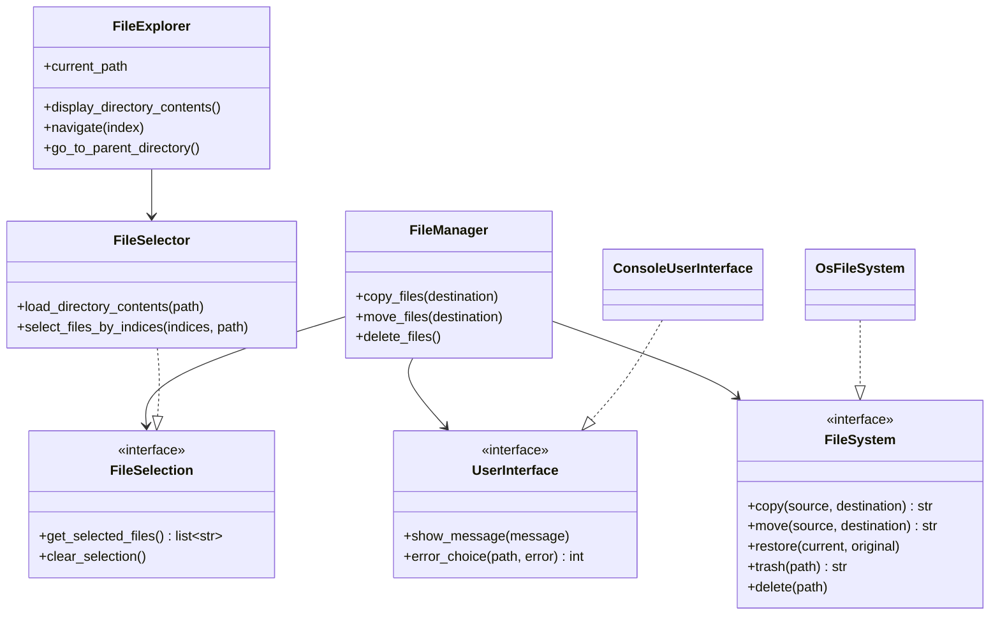

# fmgr

Gestionnaire de fichiers en console, en Python. On parcourt les dossiers, on sélectionne des fichiers, puis on les copie, les déplace ou les supprime.

Le code de départ a été généré par un LLM (premier commit du dépôt). On le reprend pour le cours "Méthodologie de tests" (EPSI, Sylvain Labasse), en binôme Maxime Mansiet et Simon Godard.

## Lancer le programme

Depuis la racine du dépôt :

```sh
python3 -m fmgr
```

## Architecture

`FileManager` ne dépend que des interfaces de `fmgr/interfaces.py`. Les classes concrètes sont créées et branchées dans `main()` (`fmgr/__main__.py`), c'est le seul endroit qui fait le câblage.



Chaque interface ne contient que ce dont `FileManager` se sert : il voit la sélection sans pouvoir la modifier autrement qu'en la vidant, et il n'a jamais accès à `print`, `input`, `os` ou `shutil`.

## Erreurs pendant une opération

Si un fichier pose problème pendant une copie, un déplacement ou une suppression, `FileManager` appelle `error_choice` et suit la réponse : 0 ignore et continue, 1 ignore toutes les erreurs suivantes de l'opération, 2 arrête l'opération, 3 annule et remet tout comme avant.

Pour pouvoir annuler une suppression, les fichiers sont d'abord renommés en fichiers cachés dans leur propre dossier, puis supprimés pour de bon à la fin de l'opération. Copie et déplacement refusent d'écraser un fichier existant, sinon l'annulation pourrait effacer un fichier qui était là avant.

## Étapes et tags

| Étape | Tag |
|---|---|
| Atelier 1, étape 1 : extraction de `FileExplorer` | `a1-etape1` |
| Atelier 1, étape 2 : inversion de contrôle | `a1-etape2` |
| Atelier 1, étape 3 : `error_choice` et annulation | `a1-etape3` |
| Rendu de l'atelier 1 | `atelier1` |
