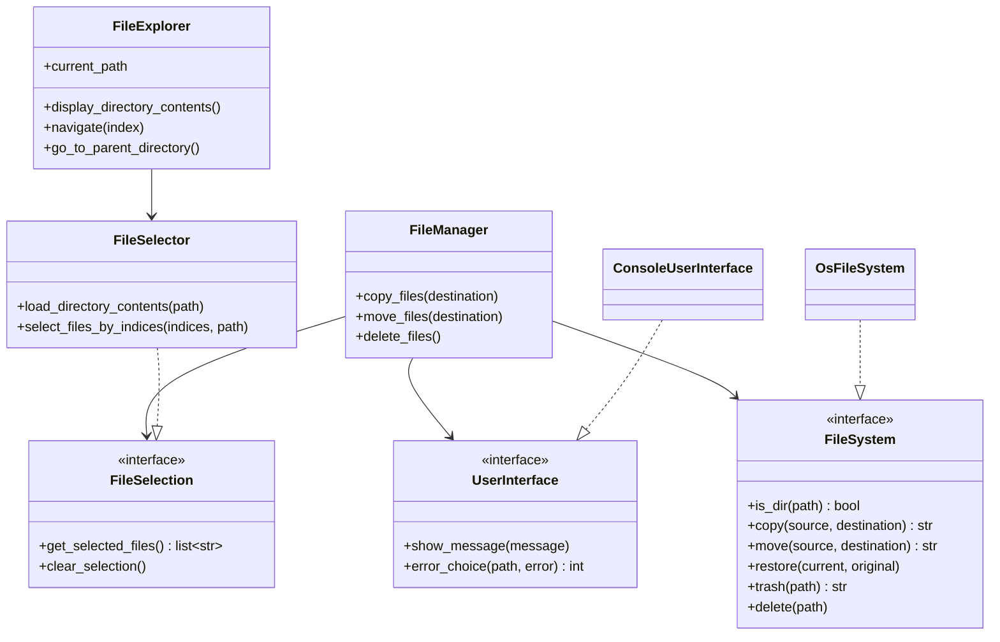

# fmgr

Gestionnaire de fichiers en console, en Python. On parcourt les dossiers, on sélectionne des fichiers, puis on les copie, les déplace ou les supprime.

Le code de départ a été généré par un LLM (premier commit du dépôt). On le reprend pour le cours "Méthodologie de tests" (EPSI, Sylvain Labasse), en binôme Maxime Mansiet et Simon Godard.

## Lancer le programme

Il faut [uv](https://docs.astral.sh/uv/). Depuis la racine du dépôt :

```sh
uv run python -m fmgr
```

## Architecture

`FileManager` ne dépend que des interfaces de `fmgr/interfaces.py`. Les classes concrètes sont créées et branchées dans `main()` (`fmgr/__main__.py`), c'est le seul endroit qui fait le câblage.



Chaque interface ne contient que ce dont `FileManager` se sert : il voit la sélection sans pouvoir la modifier autrement qu'en la vidant, et il n'a jamais accès à `print`, `input`, `os` ou `shutil`.

## Erreurs pendant une opération

Si un fichier pose problème pendant une copie, un déplacement ou une suppression, `FileManager` appelle `error_choice` et suit la réponse : 0 ignore et continue, 1 ignore toutes les erreurs suivantes de l'opération, 2 arrête l'opération, 3 annule et remet tout comme avant.

Pour pouvoir annuler une suppression, les fichiers sont d'abord renommés en fichiers cachés dans leur propre dossier, puis supprimés pour de bon à la fin de l'opération. Copie et déplacement refusent d'écraser un fichier existant, sinon l'annulation pourrait effacer un fichier qui était là avant. Une destination qui n'est pas un dossier est refusée avant de toucher quoi que ce soit.

## Tests

Les tests de `FileManager` (`tests/test_file_manager.py`) remplacent ses trois dépendances par des fakes écrits à la main (`tests/fakes.py`) : une sélection, une interface qui enregistre les messages et rejoue des choix d'erreur, et un système de fichiers en mémoire où on peut faire échouer une opération sur un chemin précis.

```sh
uv run pytest
```

Couverture des lignes et des branches :

```sh
uv run pytest --cov=fmgr --cov-branch --cov-report=term-missing
```

Seul `fmgr/file_manager.py` est visé, il est à 100 % en lignes et en branches. La console et l'explorateur ne sont pas testés, l'adaptateur `os` n'a que deux tests sur `restore` (`tests/test_os_file_system.py`).

Tests de mutation avec mutmut, configuré dans `pyproject.toml` pour ne muter que `fmgr/file_manager.py` :

```sh
uv run mutmut run
uv run mutmut results
uv run mutmut show <id du mutant>
```

Premier passage : 114 mutants, 113 tués. Le survivant était équivalent (`ignore_all = None` au lieu de `False`, pareil pour un `if`), on l'a tracé dans #1 puis exclu avec `# pragma: no mutate`. Depuis : 112/112.

## Étapes et tags

| Étape | Tag |
|---|---|
| Atelier 1, étape 1 : extraction de `FileExplorer` | `a1-etape1` |
| Atelier 1, étape 2 : inversion de contrôle | `a1-etape2` |
| Atelier 1, étape 3 : `error_choice` et annulation | `a1-etape3` |
| Rendu de l'atelier 1 | `atelier1` |
| Atelier 2, étape 1 : projet de test uv | `a2-etape1` |
| Atelier 2, étape 2 : tests et corrections de `FileManager` | `a2-etape2` |
| Atelier 2, étape 3 : couverture à 100 % et config mutmut | `a2-etape3-coverage` |
| Atelier 2, étape 3 : mutants survivants traités | `a2-etape3-mutation` |
